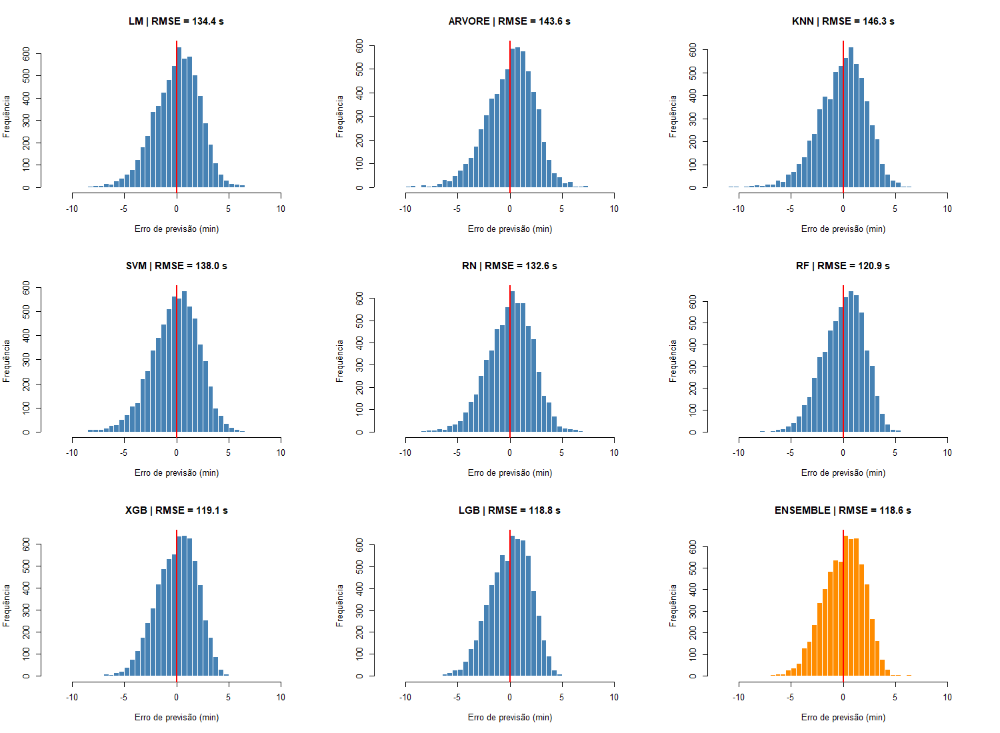
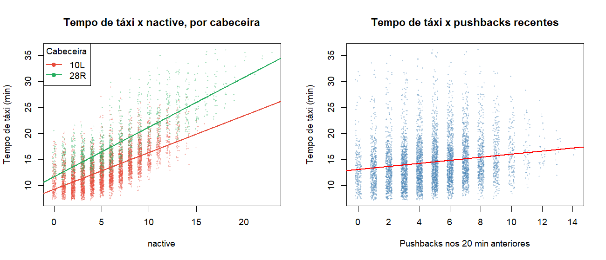

# DesceCluster · Projeto B2 (TRA-48)

**Previsão do tempo de táxi na partida no Aeroporto Internacional de São Paulo/Guarulhos (SBGR)**

TRA-48: Inteligência Analítica: Dados, Modelos e Decisões · ITA · 2º semestre de 2026 · **INFRA 27**

**Grupo DesceCluster**
- Carlos Alberto Monteiro da Cunha (Asp Monteiro)
- Matheus do Nascimento Lima dos Santos
- Guilherme Rodrigues Gomes

---

## Submissão

📦 [`submissao/data_project_test_grupoDesceCluster.Rda`](submissao/data_project_test_grupoDesceCluster.Rda)

O arquivo contém o objeto `data_test` com as mesmas 1.607 linhas, colunas e ordem de `id` da base original. A coluna `taxitime` (s) está preenchida com as previsões do modelo final.

```r
load("submissao/data_project_test_grupoDesceCluster.Rda")
summary(data_test$taxitime)
```

## Resultado

As métricas abaixo vêm da validação cruzada 5-fold na base de treino (6.426 voos), com previsões fora da amostra e as mesmas partições para todos os modelos.

| Modelo | RMSE (s) | MAE (s) | MAPE (%) |
|---|---:|---:|---:|
| **ENSEMBLE (modelo final)** | **118,57** | **95,37** | **11,54** |
| LightGBM | 118,80 | 95,53 | 11,56 |
| XGBoost | 119,12 | 95,68 | 11,59 |
| Random forest | 120,91 | 96,74 | 11,70 |
| Rede neural | 132,62 | 104,13 | 12,40 |
| Regressão linear | 134,37 | 105,40 | 12,52 |
| SVM | 138,00 | 108,01 | 12,76 |
| Árvore de regressão | 143,63 | 111,48 | 13,19 |
| KNN | 146,35 | 111,61 | 13,07 |
| Prever a média do treino (referência) | 271,19 | 206,22 | 25,03 |

O **modelo final** é uma média ponderada de quatro modelos, treinados com todos os 6.426 voos:

- LightGBM: 53,1%
- XGBoost: 23,2%
- random forest: 20,5%
- rede neural: 3,2%

O erro típico fica em torno de 2 min, para um tempo de táxi médio de 14,5 min.



## Como reproduzir

Requisitos: R ≥ 4.4 com os pacotes `data.table`, `rpart`, `caret`, `e1071`, `nnet`, `ranger`, `xgboost`, `lightgbm` e `corrplot`. O `rodar_tudo.R` instala os que faltarem.

```bash
Rscript rodar_tudo.R
```

No RStudio, defina a pasta do projeto como diretório de trabalho e rode `source("rodar_tudo.R")`. O pipeline completo leva cerca de 15 min. A busca de hiperparâmetros do boosting (script 03) só é refeita se `resultados/tuning/` estiver vazia.

| Etapa | Script | O que faz |
|---|---|---|
| 1 | [`01_preparacao.R`](scripts/01_preparacao.R) | Constrói as features a partir de `dados/data_project.Rda` |
| 2 | [`02_exploracao.R`](scripts/02_exploracao.R) | Gera estatísticas descritivas e gráficos (boxplots, scatterplots, correlograma) |
| 3 | [`03_tuning_boosting.R`](scripts/03_tuning_boosting.R) | Busca hiperparâmetros de random forest, XGBoost e LightGBM (grade + CV) |
| 4 | [`04_modelos.R`](scripts/04_modelos.R) | Compara 8 modelos e o ensemble por validação cruzada 5-fold e escolhe o modelo final |
| 5 | [`05_previsao.R`](scripts/05_previsao.R) | Treina o modelo final com toda a base de treino e gera a submissão |
| – | [`00_funcoes.R`](scripts/00_funcoes.R) | Funções compartilhadas: métricas, matrizes de entrada e definição dos modelos |

## Estrutura

```
├── rodar_tudo.R                 executa o pipeline completo
├── dados/
│   └── data_project.Rda         bases de treino (6.426 voos) e teste (1.607 voos)
├── scripts/                     00 a 05 (tabela acima)
├── resultados/
│   ├── metricas_cv.csv          RMSE, MAE e MAPE de cada modelo (CV 5-fold)
│   ├── grade_modelos_disciplina.csv
│   ├── tuning/                  grade de hiperparâmetros de RF, XGBoost e LightGBM
│   ├── estatisticas_descritivas.txt
│   ├── modelo_final.rds         hiperparâmetros e pesos do modelo final
│   ├── previsoes_oof.rds        previsões fora da amostra (CV) de cada modelo
│   ├── previsoes_teste.csv      previsões da base de teste (final e por componente)
│   └── figuras/                 gráficos exploratórios e de desempenho
└── submissao/
    └── data_project_test_grupoDesceCluster.Rda
```

## Metodologia

### 1. Pré-processamento e features

Todas as features usam apenas informação disponível no instante do pushback (`cpush`).

| Grupo | Features |
|---|---|
| Tempo | hora local (UTC−3), contínua e em codificação cíclica (seno e cosseno); dia da semana |
| Voo | companhia aérea; tipo de aeronave (tipos com menos de 20 voos agrupados); categoria de esteira (`wtc`); destino (menos de 40 voos agrupados); região do destino; doméstico × internacional |
| Pista e meteorologia | cabeceira; velocidade e direção do vento; componentes de proa e de través em relação à cabeceira (10L ≈ 095°, 28R ≈ 275°); `wx` |
| Tráfego | `nactive`; nº de pushbacks nos 10, 20, 30 e 60 min anteriores; tempo desde o pushback anterior |

Não entram como preditoras: `id`, `adep` (constante) e `crwy` (horário de decolagem, só conhecido depois do táxi).

### 2. Análise exploratória

As figuras estão em [`resultados/figuras/`](resultados/figuras) e as estatísticas em [`resultados/estatisticas_descritivas.txt`](resultados/estatisticas_descritivas.txt). Os principais achados:

- O tempo de táxi tem mediana de 13,8 min e distribuição assimétrica à direita (de 7 a 36 min).
- `nactive` é a variável mais associada ao tempo de táxi (correlação de 0,68), com crescimento aproximadamente linear.
- A inclinação da relação com `nactive` é maior na cabeceira 28R.
- A 28R é cerca de 5 min mais lenta que a 10L na média. Aeronaves pesadas, voos internacionais e voos com chuva ou baixa visibilidade (`wx`) também têm táxi mais longo.



### 3. Modelos e validação

- **Validação:** cruzada 5-fold na base de treino, com as mesmas partições para todos os modelos (`set.seed(48)`).
- **Métricas:** RMSE, MAE e MAPE fora da amostra.
- **Modelos da disciplina:** os hiperparâmetros foram escolhidos por grade (ver [`grade_modelos_disciplina.csv`](resultados/grade_modelos_disciplina.csv)).
  - **LM**: regressão linear múltipla com interações da cabeceira com `nactive`, hora, companhia e esteira.
  - **ARVORE**: árvore de regressão (CART), podada pelo menor erro de validação cruzada.
  - **KNN**: k vizinhos mais próximos, com variáveis padronizadas.
  - **SVM**: SVR com kernel radial.
  - **RN**: rede neural com 1 camada escondida, média de 3 inicializações.
- **Ensembles de árvores:** os hiperparâmetros vêm do script 03 (ver [`resultados/tuning/`](resultados/tuning)).
  - **RF**: random forest.
  - **XGB**: XGBoost.
  - **LGB**: LightGBM.
  - O nº de árvores do boosting é escolhido por parada antecipada.
- **ENSEMBLE:** média ponderada das previsões dos modelos, com pesos não negativos que somam 1, estimados por mínimos quadrados sobre as previsões fora da amostra.
  - O desempenho reportado é honesto: os pesos aplicados em cada dobra são estimados sem aquela dobra.

### 4. Modelo final

| Componente | Peso | Hiperparâmetros |
|---|---:|---|
| LightGBM | 0,531 | 63 folhas; mín. 5 voos por folha; `feature_fraction` 0,5; `bagging_fraction` 0,8; λ₂ = 1; taxa 0,02; 583 árvores; média de 5 sementes |
| XGBoost | 0,232 | profundidade 10; `min_child_weight` 5; `colsample_bytree` 0,5; `subsample` 0,8; eta 0,02; 514 árvores; média de 5 sementes |
| Random forest | 0,205 | 1.000 árvores; `mtry` 8; `min.node.size` 1 |
| Rede neural | 0,032 | 1 camada com 3 neurônios; `decay` 1; média de 3 inicializações |

As previsões são limitadas à faixa de `taxitime` observada no treino (434 a 2.168 s).

### 5. O que foi testado e descartado

Nada disto melhorou o RMSE da validação cruzada:

- alvo em escala log;
- categorias nativas do LightGBM no lugar de one-hot;
- dia do mês;
- desempenho recente do aeroporto (tempo de táxi médio das últimas decolagens e nº de aeronaves taxiando);
- pushbacks recentes da mesma companhia, do mesmo tipo de destino ou de aeronaves pesadas.
